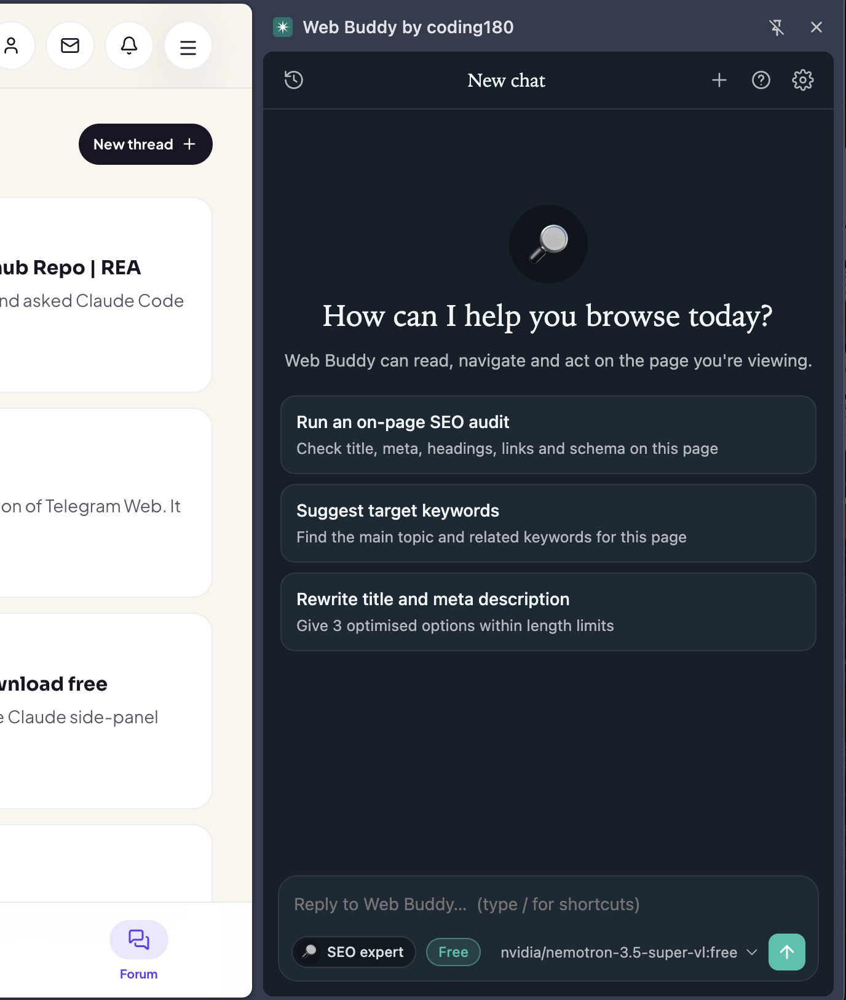
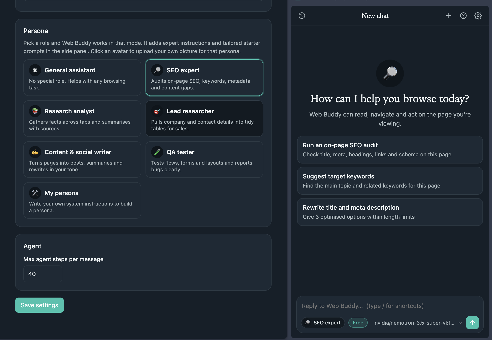

# Web Buddy by coding180

An AI browsing agent in your Chrome side panel. It reads the page you're on, answers questions about it, and clicks, types, scrolls and navigates for you, using any model available on [OpenRouter](https://openrouter.ai), free or paid. No build step, no dependencies.

An independent re-implementation of the "Claude in Chrome" side-panel agent. Not affiliated with or endorsed by Anthropic or OpenRouter.



## Install

1. Download or clone this repo.
2. Open `chrome://extensions` and turn on **Developer mode**.
3. Click **Load unpacked** and select this folder.
4. The options page opens on install. Paste your OpenRouter key ([get one free](https://openrouter.ai/keys)), then click **Save API Key** and **Test connection**.
5. Click the toolbar icon, or press ⌘E / Ctrl+E, to open the side panel.

After changing any file, reload the extension on `chrome://extensions` (and reload the page you're testing on).

## Features

- **Side panel chat:** streaming markdown, tool timeline, screenshots, chat history, `/shortcuts`, model picker, stop button
- **Free or paid models:** free models are live-checked before they're listed, with automatic failover if one is rate limited
- **Personas:** General assistant, SEO expert, Research analyst, Lead researcher, Content & social writer, QA tester, or write your own, each with its own avatar
- **Page tools:** click, type, key, scroll, drag, zoom, screenshot, read page, find elements, page text, navigate, fill forms, run JavaScript, read console, manage tabs, plan approval
- **You stay in control:** asks before acting on a new site, with a per-site allow list, and a glow indicator while it acts
- **Light and dark themes**



## Good to know

- Pick a tool-calling model. Screenshots need a vision-capable model.
- It uses `chrome.debugger`, so Chrome shows a "debugging this browser" banner while the agent is working.
- Your API key and chats are stored only in your browser (`chrome.storage.local`). Page content you ask about is sent to OpenRouter and the model you chose; nothing goes to coding180.
- Not included: claude.ai login, scheduled tasks, workflow recording, MCP bridge, Google Workspace tools.

## Project layout

```
manifest.json         Extension manifest (MV3)
service-worker.js     Agent loop and tool execution
sidepanel.*           Chat UI
options.*             Settings, permissions, shortcuts, About
content/              Accessibility tree and page glow indicator
lib/                  OpenRouter client, models, personas, tools, settings
store/                Chrome Web Store listing and privacy policy
```

## Credits

Developed by **coding180**, built with the REA (reverse-engineer-anything) tool as a clean-room re-implementation.

## Forum, more apps and contact

- Source, discussion and more reverse-engineered apps: **https://coding180.com/forum/reverse-engineer/clone-claude-chrome-extension-rea**
- Contact the developer for custom versions: https://coding180.com/contact
